## **1.创建型设计模式 5**

### **1.三种工厂模式的区别总结**

| 模式                     | 工厂数量 | 负责创建       | 主要用途                 |
| ---------------------- | ---- | ---------- | -------------------- |
| 简单工厂（Simple Factory）   | 1 个  | 所有产品       | 工厂集中控制创建逻辑           |
| 普通工厂（Factory Method）   | 多个   | 每个工厂对应一种产品 | 新增产品时无需改原工厂类，只需新增工厂类 |
| 抽象工厂（Abstract Factory） | 多个   | 一系列相关产品    | 创建产品族（如 CPU + 主板）    |

-------------------- ----------------- ---------------------- ------------------------------------------

### **2.简单工厂模式（Factory Pattern）**

**核心思想：**

由一个工厂类根据传入参数决定创建哪种具体对象。

类图：

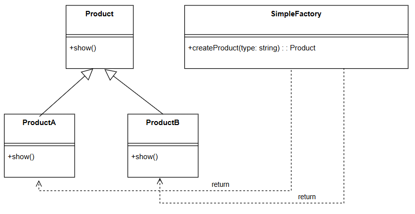

```cpp

#include \<iostream\>

#include \<memory\>

using namespace std;

// 产品抽象类

class Product {

public:

virtual void show() = 0;

virtual \~Product() = default;

};

// 具体产品A

class ProductA : public Product {

public:

void show() override {

cout \<\< \"This is Product A\" \<\< endl;

}

};

// 具体产品B

class ProductB : public Product {

public:

void show() override {

cout \<\< \"This is Product B\" \<\< endl;

}

};

// 简单工厂类

class SimpleFactory {

public:

static unique_ptr\<Product\> createProduct(const string& type) {

if (type == \"A\") return make_unique\<ProductA\>();

if (type == \"B\") return make_unique\<ProductB\>();

return nullptr;

}

};

int main() {

auto product1 = SimpleFactory::createProduct(\"A\");

auto product2 = SimpleFactory::createProduct(\"B\");

product1-\>show();

product2-\>show();

return 0;

}
```

### **3.普通工厂模式示例（Factory Method）**

定义一个创建对象的接口，但是==由子类决定需要实例化哪一个类==。一个工厂只生产一个产品

类图：

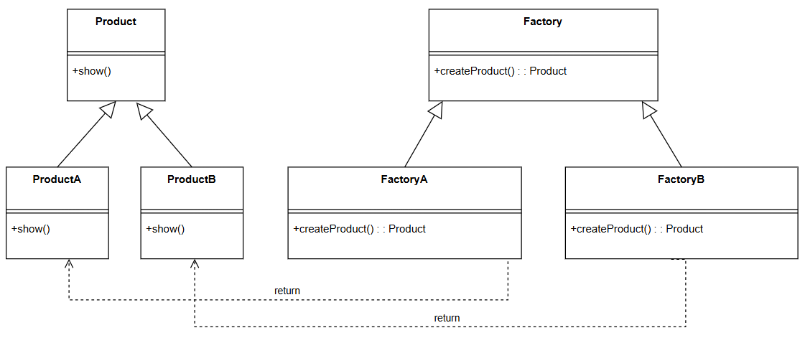

```cpp


#include \<iostream\>

#include \<memory\>

using namespace std;

// 抽象产品类

class Product {

public:

virtual void show() = 0;

virtual \~Product() = default;

};

// 具体产品A

class ProductA : public Product {

public:

void show() override {

cout \<\< \"This is Product A\" \<\< endl;

}

};

// 具体产品B

class ProductB : public Product {

public:

void show() override {

cout \<\< \"This is Product B\" \<\< endl;

}

};

// 抽象工厂类（定义创建接口）

class Factory {

public:

virtual unique_ptr\<Product\> createProduct() = 0;

virtual \~Factory() = default;

};

// 具体工厂A ------ 生产 ProductA

class FactoryA : public Factory {

public:

unique_ptr\<Product\> createProduct() override {

return make_unique\<ProductA\>();

}

};

// 具体工厂B ------ 生产 ProductB

class FactoryB : public Factory {

public:

unique_ptr\<Product\> createProduct() override {

return make_unique\<ProductB\>();

}

};

int main() {

unique_ptr\<Factory\> factoryA = make_unique\<FactoryA\>();

auto productA = factoryA-\>createProduct();

productA-\>show();

unique_ptr\<Factory\> factoryB = make_unique\<FactoryB\>();

auto productB = factoryB-\>createProduct();

productB-\>show();

return 0;

}
```

### **4.抽象工厂模式（Abstract Factory Pattern）**

**核心思想：**

用于创建==一系列==相关的对象（不同产品族），而==无需指定具体类==。

Abstract Factory 抽象工厂

Concrete Factory 具体工厂

类图：

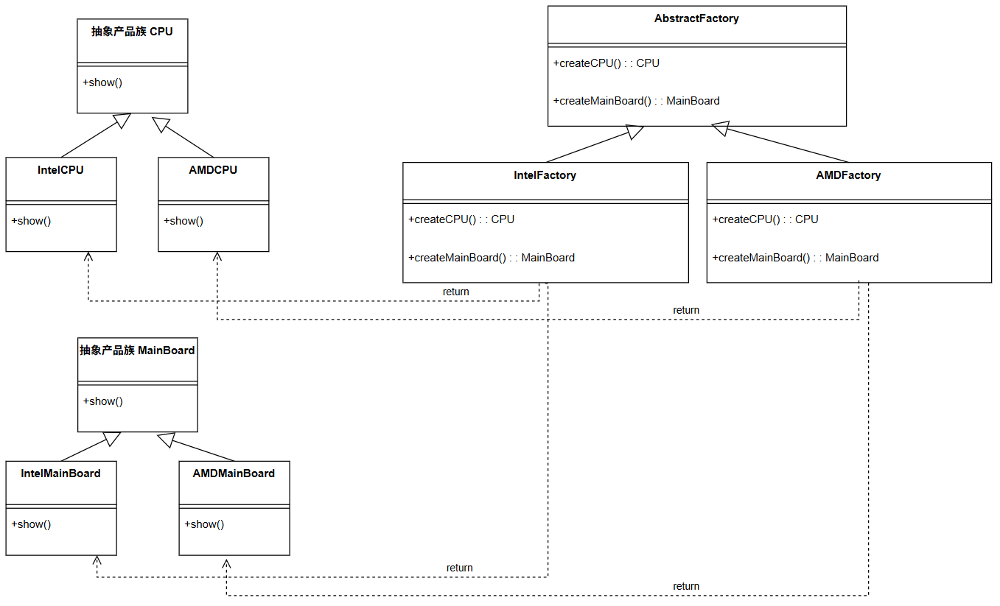

```cpp


#include \<iostream\>

#include \<memory\>

using namespace std;

// 抽象产品族：CPU 和 MainBoard

class CPU {

public:

virtual void show() = 0;

virtual \~CPU() = default;

};

class MainBoard {

public:

virtual void show() = 0;

virtual \~MainBoard() = default;

};

// 具体产品：Intel 系列

class IntelCPU : public CPU {

public:

void show() override {

cout \<\< \"Intel CPU\" \<\< endl;

}

};

class IntelMainBoard : public MainBoard {

public:

void show() override {

cout \<\< \"Intel MainBoard\" \<\< endl;

}

};

// 具体产品：AMD 系列

class AMDCPU : public CPU {

public:

void show() override {

cout \<\< \"AMD CPU\" \<\< endl;

}

};

class AMDMainBoard : public MainBoard {

public:

void show() override {

cout \<\< \"AMD MainBoard\" \<\< endl;

}

};

// 抽象工厂

class AbstractFactory {

public:

virtual unique_ptr\<CPU\> createCPU() = 0;

virtual unique_ptr\<MainBoard\> createMainBoard() = 0;

virtual \~AbstractFactory() = default;

};

// 具体工厂：Intel 工厂

class IntelFactory : public AbstractFactory {

public:

unique_ptr\<CPU\> createCPU() override {

return make_unique\<IntelCPU\>();

}

unique_ptr\<MainBoard\> createMainBoard() override {

return make_unique\<IntelMainBoard\>();

}

};

// 具体工厂：AMD 工厂

class AMDFactory : public AbstractFactory {

public:

unique_ptr\<CPU\> createCPU() override {

return make_unique\<AMDCPU\>();

}

unique_ptr\<MainBoard\> createMainBoard() override {

return make_unique\<AMDMainBoard\>();

}

};

int main() {

unique_ptr\<AbstractFactory\> factory = make_unique\<IntelFactory\>();

auto cpu = factory-\>createCPU();

auto board = factory-\>createMainBoard();

cpu-\>show();

board-\>show();

factory = make_unique\<AMDFactory\>();

cpu = factory-\>createCPU();

board = factory-\>createMainBoard();

cpu-\>show();

board-\>show();

return 0;

}
```

### **5.原型模式（Prototype）**

**核心思想：**

通过\*\*==复制==已有对象（==原型==）\*\*来==创建新对象（所以叫创建型）==，而不是通过
new 或复杂构造函数创建。

对象的结构、初始状态由原型定义，克隆操作实现快速、可定制的实例生成。

**关键点：**

- 接口：定义 clone() 方法，返回自身的深拷贝。

- 目的：避免重复构造复杂对象，提高创建效率。==快！省资源！==

- 应用场景：

    对象创建开销大（如含大量配置或外部资源）。

    需要保存多种预设模板并动态复制。

- 优点：

    对客户端透明地创建复杂对象。

    易于动态扩展原型种类。

- 缺点：

    深拷贝实现复杂，需关注资源与指针。

**结构要点：**

```
Prototype（抽象原型） → 定义 clone 接口

ConcretePrototype（具体原型） → 实现 clone

Client（客户端） → 通过 clone 创建对象
```

**类图：**

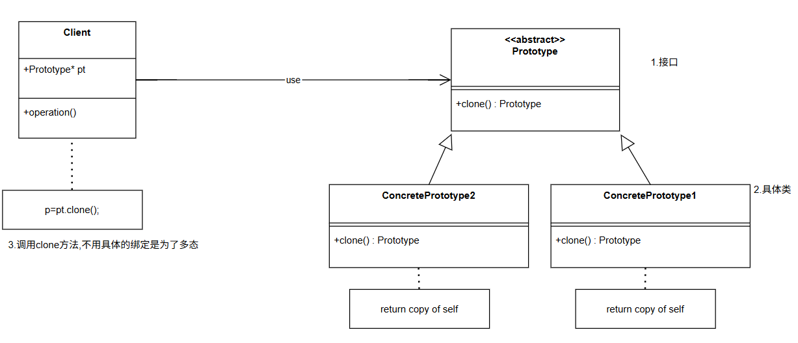

**代码：**

```cpp


// language: cpp

#include \<iostream\>

#include \<memory\>

// 抽象原型类

class Prototype {

public:

virtual \~Prototype() = default;

virtual Prototype\* clone() const = 0;

virtual void show() const = 0;

};

// 具体原型类1

class ConcretePrototype1 : public Prototype {

int value;

public:

ConcretePrototype1(int v) : value(v) {}

ConcretePrototype1(const ConcretePrototype1& other) : value(other.value)
{}

Prototype\* clone() const override {

return new ConcretePrototype1(\*this);

}

void show() const override {

std::cout \<\< \"ConcretePrototype1 value = \" \<\< value \<\<
std::endl;

}

};

// 具体原型类2

class ConcretePrototype2 : public Prototype {

std::string name;

public:

ConcretePrototype2(std::string n) : name(std::move(n)) {}

ConcretePrototype2(const ConcretePrototype2& other) : name(other.name)
{}

Prototype\* clone() const override {

return new ConcretePrototype2(\*this);

}

void show() const override {

std::cout \<\< \"ConcretePrototype2 name = \" \<\< name \<\< std::endl;

}

};

// 客户端

class Client {

Prototype\* prototype;

public:

Client(Prototype\* p) : prototype(p) {}

void operation() {

Prototype\* copy = prototype-\>clone();

copy-\>show();

delete copy;

}

};

// 示例

int main() {

ConcretePrototype1 p1(42);

Client c1(&p1);

c1.operation();

ConcretePrototype2 p2(\"Prototype B\");

Client c2(&p2);

c2.operation();

return 0;

}
```

### **6.单例模式（Singleton Pattern）**

**核心思想：**

保证**==一个类在系统中只有一个实例==**，并提供一个==全局访问点==。（静态的，不需要对象，直接通过类名调用）

**关键点：**

- 控制实例数量：构造函数私有化，禁止复制与赋值。

- 提供全局访问点：通过静态函数 instance() 获取唯一实例。

- 线程安全实现：

    C++11 起：

    static 局部变量初始化保证线程安全（Meyers 单例）。

    复杂场景可用

std::call_once。

**应用场景：**

- 全局资源管理（如配置中心、日志器、驱动实例）。

- 控制访问唯一硬件接口、注册表或连接池。

**优点：**

- 全局唯一、延迟创建。

- 管理共享资源一致性。

**缺点：**

- 增加全局状态，可能影响单元测试与可扩展性。

**结构要点：**

- Singleton → 私有构造 + 静态访问函数 + 禁止拷贝

**类图：**

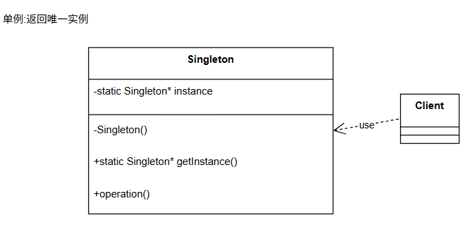

**代码：**

```cpp


// language: cpp

#include \<iostream\>

class Singleton {

private:

static Singleton\* instance; // 唯一实例指针

Singleton() { // 私有构造函数

std::cout \<\< \"Singleton constructor called.\\n\";

}

public:

// 禁止拷贝与赋值（教材中可不写，此处补充标准写法）

Singleton(const Singleton&) = delete;

Singleton& operator=(const Singleton&) = delete;

static Singleton\* getInstance() {

if (instance == nullptr) { // 第一次调用时创建对象

instance = new Singleton();

}

return instance;

}

void operation() {

std::cout \<\< \"Singleton operation executed.\\n\";

}

};

// 静态成员初始化

Singleton\* Singleton::instance = nullptr;

// 客户端代码

int main() {

Singleton\* s1 = Singleton::getInstance();

Singleton\* s2 = Singleton::getInstance();

s1-\>operation();

// 验证两个指针相同

std::cout \<\< \"s1 == s2 ? \" \<\< (s1 == s2 ? \"true\" : \"false\")
\<\< std::endl;

return 0;

}
```

### **7.生成器/构建器模式（Builder）**

**目的：**

将一个复杂对象的**==构建过程与其表示分离==**，使得==同样的构建过程==可以创建==不同的表示==。（比如放入不同的菜炒出不同的菜）

**关键角色：**

1. Builder（抽象建造者）

：定义创建产品各部分的抽象接口。

2. ConcreteBuilder（具体建造者）

：实现 Builder 接口，具体构造和装配产品的部件。

3. Director（指挥者）

：调用建造者的步骤方法，控制产品构建过程。

4. Product（产品类）

：表示被创建的复杂对象。

**适用场景：**

- 对象由多个部件组成且创建过程复杂。

- 创建过程固定，但产品的具体表示不同。

**优点：**

- 使构建代码与产品表示分离。

- 可复用构建流程创建不同对象。

**类图：**

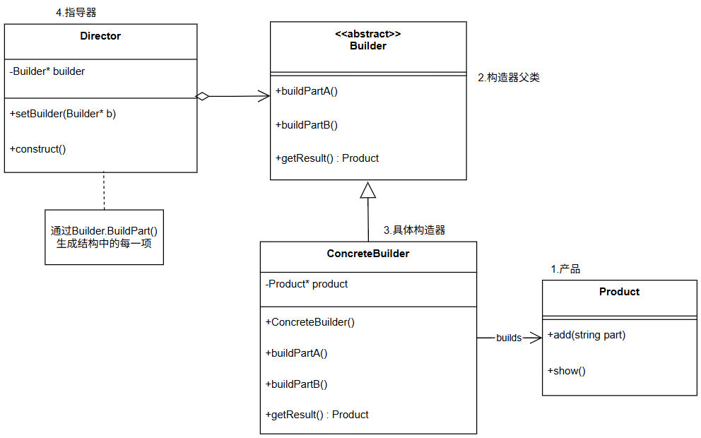

**代码：**

```cpp

// language: cpp

#include \<iostream\>

#include \<vector\>

#include \<string\>

using namespace std;

// 产品类

class Product {

vector\<string\> parts;

public:

void add(const string& part) { parts.push_back(part); }

void show() {

cout \<\< \"Product parts: \";

for (auto& p : parts) cout \<\< p \<\< \" \";

cout \<\< endl;

}

};

// 抽象建造者

class Builder {

public:

virtual \~Builder() = default;

virtual void buildPartA() = 0;

virtual void buildPartB() = 0;

virtual Product\* getResult() = 0;

};

// 具体建造者

class ConcreteBuilder : public Builder {

Product\* product;

public:

ConcreteBuilder() { product = new Product(); }

void buildPartA() override { product-\>add(\"PartA\"); }

void buildPartB() override { product-\>add(\"PartB\"); }

Product\* getResult() override { return product; }

};

// 指挥者

class Director {

Builder\* builder;

public:

void setBuilder(Builder\* b) { builder = b; }

void construct() {

builder-\>buildPartA();

builder-\>buildPartB();

}

};

// 客户端

int main() {

Director director;

ConcreteBuilder builder;

director.setBuilder(&builder);

director.construct();

Product\* product = builder.getResult();

product-\>show();

delete product; // 清理

return 0;

}
```

## **2.结构型设计模式 7**

### **1.适配器模式（Adapter）**

**核心思想：**

适配器模式（Adapter
Pattern）的核心是**将==一个类的接口==转换成客户==希望的另一个接口==**，使原本接口不兼容的类能够一起工作。

它是一种**结构型设计模式**，主要解决"接口不匹配"问题。

------------------------------------------------------------------------

适配器模式包含以下角色：

1. Target（目标接口）：客户期望的接口。

2. Adaptee（被适配者）：已有接口，但与目标接口不兼容。

3. Adapter（适配器）：将 Adaptee 的接口转换成 Target 的接口。

------------------------------------------------------------------------

**类图：**

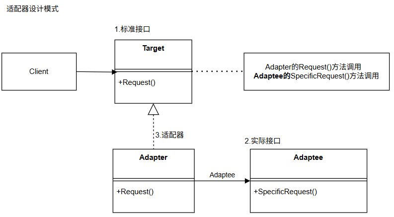

**代码：**

```cpp

#include \<iostream\>

using namespace std;

// 目标接口

class Target {

public:

virtual void Request() = 0;

virtual \~Target() = default;

};

// 被适配者（已有功能）

class Adaptee {

public:

void SpecificRequest() {

cout \<\< \"Adaptee: SpecificRequest() called.\" \<\< endl;

}

};

// 适配器

class Adapter : public Target {

private:

Adaptee\* adaptee;

public:

Adapter(Adaptee\* a) : adaptee(a) {}

void Request() override {

cout \<\< \"Adapter: converting Request() to SpecificRequest().\" \<\<
endl;

adaptee-\>SpecificRequest();

}

};

// 客户端

int main() {

Adaptee\* adaptee = new Adaptee();

Target\* target = new Adapter(adaptee);

target-\>Request();

delete target;

delete adaptee;

return 0;

}
```

### **2.桥接模式（Bridge）**

**核心思想：**

桥接模式（Bridge
Pattern）的核心是**==将抽象部分与实现部分分离，使它们可以独立变化==**。

它是一种**结构型设计模式**，主要解决"多维度变化"的问题，比如**抽象层次**与**实现层次**都可能变化时避免类爆炸。

------------------------------------------------------------------------

1. Abstraction（抽象类）：定义高层抽象接口，包含对实现部分的引用。

2. RefinedAbstraction（扩展抽象类）：在抽象接口基础上扩展。

3. Implementor（实现接口）：定义实现部分的接口。

4. ConcreteImplementor（具体实现类）：实现 Implementor 接口。

------------------------------------------------------------------------

**类图：例：把功能桥接入手机**

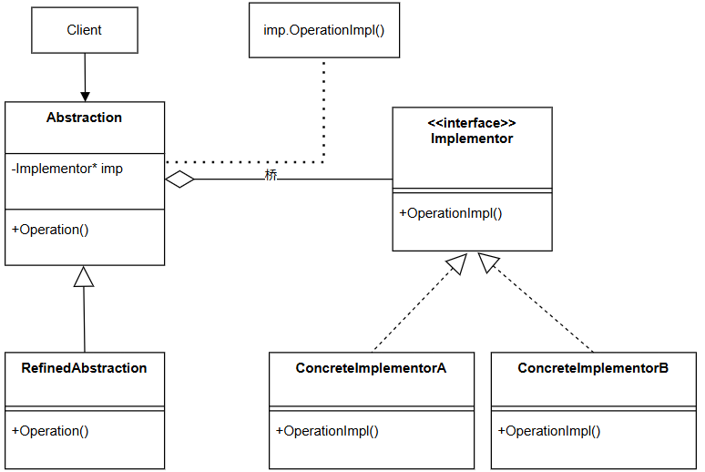

**代码：**

```cpp

#include \<iostream\>

using namespace std;

// 实现接口

class Implementor {

public:

virtual void OperationImpl() = 0;

virtual \~Implementor() = default;

};

// 具体实现A

class ConcreteImplementorA : public Implementor {

public:

void OperationImpl() override {

cout \<\< \"ConcreteImplementorA: 实现操作A\" \<\< endl;

}

};

// 具体实现B

class ConcreteImplementorB : public Implementor {

public:

void OperationImpl() override {

cout \<\< \"ConcreteImplementorB: 实现操作B\" \<\< endl;

}

};

// 抽象类

class Abstraction {

protected:

Implementor\* imp;

public:

Abstraction(Implementor\* implementor) : imp(implementor) {}

virtual void Operation() {

imp-\>OperationImpl();

}

virtual \~Abstraction() = default;

};

// 扩展抽象类

class RefinedAbstraction : public Abstraction {

public:

RefinedAbstraction(Implementor\* implementor) : Abstraction(implementor)
{}

void Operation() override {

cout \<\< \"RefinedAbstraction: 扩展操作 -\> \";

imp-\>OperationImpl();

}

};

// 客户端

int main() {

Implementor\* implA = new ConcreteImplementorA();

Implementor\* implB = new ConcreteImplementorB();

Abstraction\* abs1 = new RefinedAbstraction(implA);

Abstraction\* abs2 = new RefinedAbstraction(implB);

abs1-\>Operation();

abs2-\>Operation();

delete abs1;

delete abs2;

delete implA;

delete implB;

return 0;

}
```

### **3.组合模式（Composite Pattern）**

**核心思想：**

组合模式（Composite
Pattern）的核心是**将对象组合成==树形结构==以表示"整体--部分"的==层次结构==**，使得客户对单个对象和组合对象的使用具有一致性。

它是一种**结构型设计模式**，解决"单个对象与组合对象操作不一致"的问题。

------------------------------------------------------------------------

1. Component（抽象构件）：定义叶子和容器的公共接口。

2. Leaf（叶子节点）：表示树的最小单位，没有子节点。

3. Composite（容器节点）：可以包含子节点，实现对 Component 的统一操作。

4. Client（客户端）：通过 Component 接口统一处理单个对象和组合对象。

------------------------------------------------------------------------

**类图：**

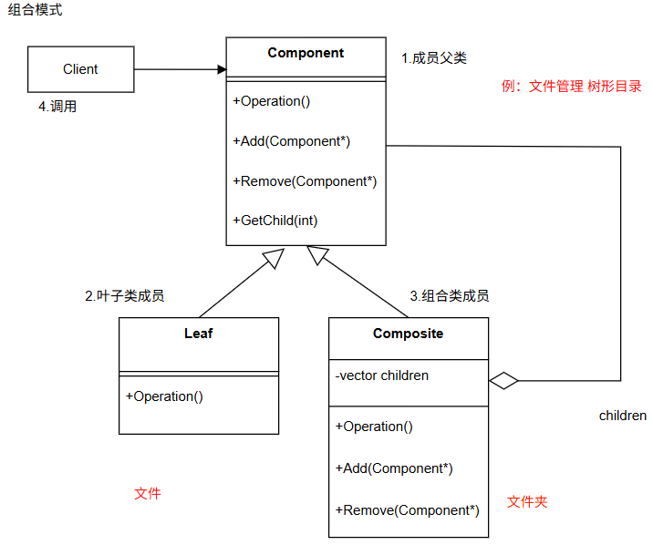

**代码：**

```cpp

#include \<iostream\>

#include \<vector\>

#include \<string\>

using namespace std;

// 抽象构件

class Component {

public:

virtual void Operation() = 0;

virtual void Add(Component\* c) {}

virtual void Remove(Component\* c) {}

virtual \~Component() = default;

};

// 叶子节点

class Leaf : public Component {

private:

string name;

public:

explicit Leaf(const string& n) : name(n) {}

void Operation() override {

cout \<\< \"Leaf: \" \<\< name \<\< endl;

}

};

// 容器节点

class Composite : public Component {

private:

vector\<Component\*\> children;

string name;

public:

explicit Composite(const string& n) : name(n) {}

void Add(Component\* c) override {

children.push_back(c);

}

void Remove(Component\* c) override {

children.erase(remove(children.begin(), children.end(), c),
children.end());

}

void Operation() override {

cout \<\< \"Composite: \" \<\< name \<\< endl;

for (auto\* child : children)

child-\>Operation();

}

\~Composite() {

for (auto\* c : children)

delete c;

}

};

// 客户端

int main() {

Composite\* root = new Composite(\"Root\");

root-\>Add(new Leaf(\"Leaf A\"));

root-\>Add(new Leaf(\"Leaf B\"));

Composite\* sub = new Composite(\"SubComposite\");

sub-\>Add(new Leaf(\"Leaf X\"));

sub-\>Add(new Leaf(\"Leaf Y\"));

root-\>Add(sub);

root-\>Operation();

delete root;

return 0;

}
```

### **4.装饰模式（Decorator Pattern）**

**核心思想：**

装饰模式（Decorator
Pattern）的核心是**在不改变原有类结构的前提下，==动态地给对象添加新的功能==**。

它是一种**结构型设计模式**，用于替代继承实现功能扩展，使功能增强更灵活。

------------------------------------------------------------------------

1. Component（抽象构件）：定义对象的接口，可以被动态扩展。

2. ConcreteComponent（具体构件）：被装饰的原始对象，提供基本功能。

3. Decorator（装饰抽象类）：持有一个 Component 对象引用，并实现与 Component
   相同的接口。

4. ConcreteDecorator（具体装饰类）：在原有功能上动态扩展新行为。

**类图：**

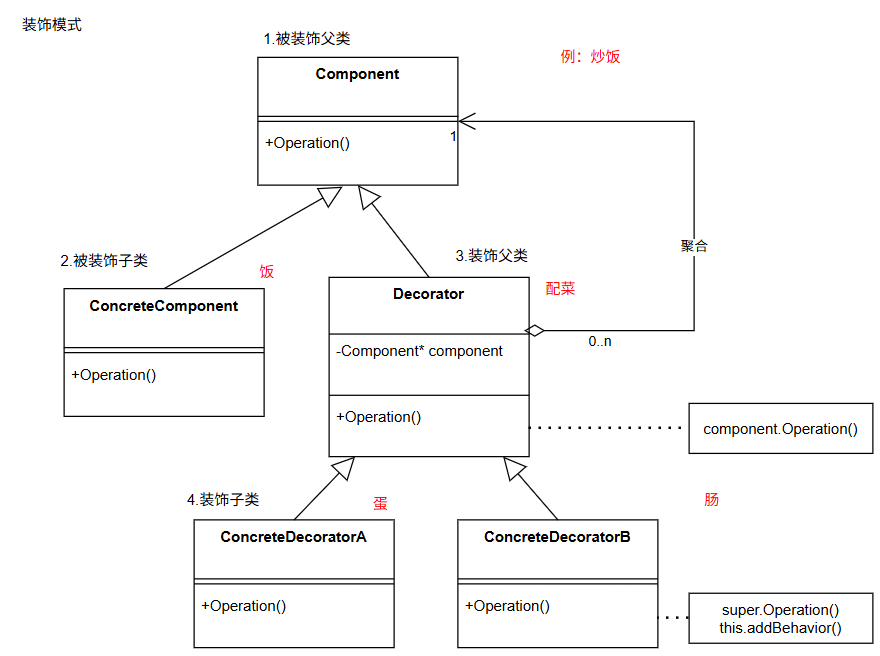

**代码：**

```cpp

#include \<iostream\>

using namespace std;

// 抽象构件

class Component {

public:

virtual void Operation() = 0;

virtual \~Component() = default;

};

// 具体构件

class ConcreteComponent : public Component {

public:

void Operation() override {

cout \<\< \"ConcreteComponent: 基本功能\" \<\< endl;

}

};

// 装饰抽象类

class Decorator : public Component {

protected:

Component\* component;

public:

explicit Decorator(Component\* c) : component(c) {}

void Operation() override {

component-\>Operation();

}

};

// 具体装饰A

class ConcreteDecoratorA : public Decorator {

public:

explicit ConcreteDecoratorA(Component\* c) : Decorator(c) {}

void Operation() override {

Decorator::Operation();

AddedBehaviorA();

}

private:

void AddedBehaviorA() {

cout \<\< \"ConcreteDecoratorA: 扩展功能A\" \<\< endl;

}

};

// 具体装饰B

class ConcreteDecoratorB : public Decorator {

public:

explicit ConcreteDecoratorB(Component\* c) : Decorator(c) {}

void Operation() override {

Decorator::Operation();

AddedBehaviorB();

}

private:

void AddedBehaviorB() {

cout \<\< \"ConcreteDecoratorB: 扩展功能B\" \<\< endl;

}

};

// 客户端

int main() {

Component\* base = new ConcreteComponent();

Component\* decoA = new ConcreteDecoratorA(base);

Component\* decoB = new ConcreteDecoratorB(decoA);

decoB-\>Operation(); // 动态组合装饰

delete decoB;

delete decoA;

delete base;

return 0;

}
```

### **5.外观模式（Facade Pattern）**

**核心思想：**

外观模式（Facade
Pattern）的核心是**为子系统中的==一组接口==提供==一个统一的高层接口==，使子系统更易使用**。

它是一种**结构型设计模式**，主要解决**系统复杂度过高、接口繁杂**的问题。

------------------------------------------------------------------------

1. Facade（外观类）：对外提供统一接口，封装内部子系统调用。

2. Subsystem Classes（子系统类）：实现具体功能，外部通过 Facade 访问。

3. Client（客户端）：仅与 Facade 交互，不直接访问子系统。

**类图：**

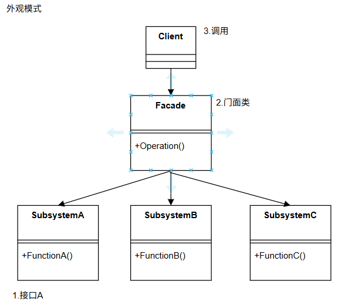

**代码：**

```cpp

#include \<iostream\>

using namespace std;

// 子系统A

class SubsystemA {

public:

void FunctionA() {

cout \<\< \"SubsystemA: 初始化系统资源\" \<\< endl;

}

};

// 子系统B

class SubsystemB {

public:

void FunctionB() {

cout \<\< \"SubsystemB: 启动核心服务\" \<\< endl;

}

};

// 子系统C

class SubsystemC {

public:

void FunctionC() {

cout \<\< \"SubsystemC: 检查运行状态\" \<\< endl;

}

};

// 外观类

class Facade {

private:

SubsystemA a;

SubsystemB b;

SubsystemC c;

public:

void Operation() {

cout \<\< \"Facade: 一键启动系统\" \<\< endl;

a.FunctionA();

b.FunctionB();

c.FunctionC();

cout \<\< \"Facade: 系统已启动\" \<\< endl;

}

};

// 客户端

int main() {

Facade facade;

facade.Operation();

return 0;

}
```

### **6.享元模式（Flyweight Pattern）**

**核心思想：**

享元模式（Flyweight
Pattern）的核心是**通过共享对象来减少内存消耗**，适用于存在大量相似对象的场景，提供大量==细粒度==对象==共享元对象==。

它是一种**结构型设计模式**，主要解决**对象过多导致内存开销大**的问题。

------------------------------------------------------------------------

1. Flyweight（享元接口）：定义可共享对象的通用接口。

2. ConcreteFlyweight（具体享元类）：实现享元接口，存储**内部状态（可共享）**。

3. UnsharedConcreteFlyweight（非共享享元类）：不共享的特殊对象。

4. FlyweightFactory（享元工厂）：创建和管理共享对象，保证相同内部状态对象共享。

5. Client（客户端）：维护外部状态，使用享元对象。

**类图：**

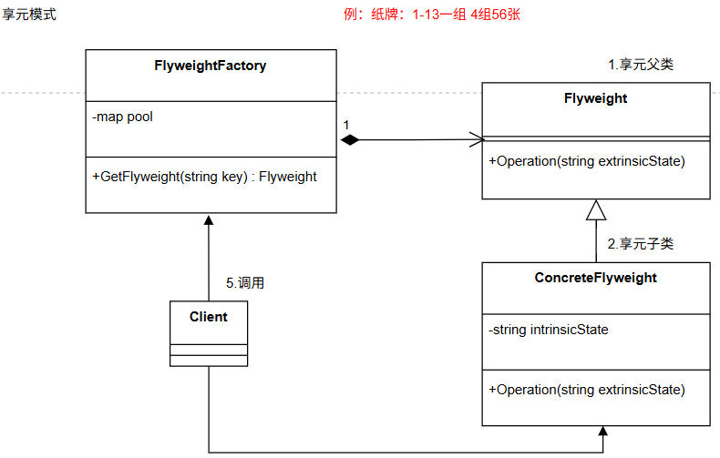

**代码：**

```cpp

#include \<iostream\>

#include \<string\>

#include \<map\>

using namespace std;

// 享元接口

class Flyweight {

public:

virtual void Operation(const string& extrinsicState) = 0;

virtual \~Flyweight() = default;

};

// 具体享元类（可共享对象）

class ConcreteFlyweight : public Flyweight {

private:

string intrinsicState; // 内部状态（共享部分）

public:

explicit ConcreteFlyweight(const string& state) : intrinsicState(state)
{}

void Operation(const string& extrinsicState) override {

cout \<\< \"ConcreteFlyweight: 内部状态\[\" \<\< intrinsicState

\<\< \"\] 外部状态\[\" \<\< extrinsicState \<\< \"\]\" \<\< endl;

}

};

// 享元工厂

class FlyweightFactory {

private:

map\<string, Flyweight\*\> pool; // 享元池

public:

Flyweight\* GetFlyweight(const string& key) {

if (pool.find(key) == pool.end()) {

pool\[key\] = new ConcreteFlyweight(key);

cout \<\< \"创建新享元对象: \" \<\< key \<\< endl;

} else {

cout \<\< \"复用已有享元对象: \" \<\< key \<\< endl;

}

return pool\[key\];

}

\~FlyweightFactory() {

for (auto& kv : pool) delete kv.second;

}

};

// 客户端

int main() {

FlyweightFactory factory;

Flyweight\* fw1 = factory.GetFlyweight(\"A\");

fw1-\>Operation(\"外部状态1\");

Flyweight\* fw2 = factory.GetFlyweight(\"A\");

fw2-\>Operation(\"外部状态2\");

Flyweight\* fw3 = factory.GetFlyweight(\"B\");

fw3-\>Operation(\"外部状态3\");

return 0;

}
```

### **7.代理模式（Proxy Pattern）**

**核心思想：**

代理模式（Proxy Pattern）的核心是**为某个对象==提供一个代理==对象，以控制对该对象的访问**。==隔离==

它是一种**结构型设计模式**，主要用于**访问控制、延迟加载、远程访问、性能优化等**场景。

------------------------------------------------------------------------

1. Subject（抽象主题）：定义真实对象和代理的公共接口。

2. RealSubject（真实主题）：实际执行业务逻辑的对象。

3. Proxy（代理）：持有 RealSubject
   的引用，在调用前后进行附加操作（如权限、日志、缓存等）。

4. Client（客户端）：通过 Subject 接口访问对象，不关心是否为代理。

**类图：**

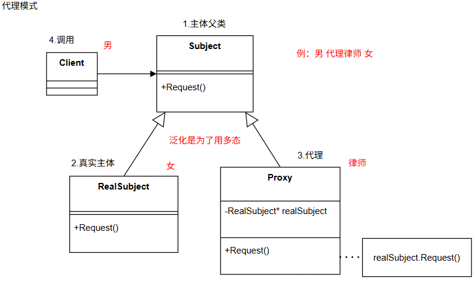

**代码：**

```cpp

#include \<iostream\>

using namespace std;

// 抽象主题

class Subject {

public:

virtual void Request() = 0;

virtual \~Subject() = default;

};

// 真实主题

class RealSubject : public Subject {

public:

void Request() override {

cout \<\< \"RealSubject: 执行实际请求。\" \<\< endl;

}

};

// 代理类

class Proxy : public Subject {

private:

RealSubject\* realSubject;

bool accessGranted;

bool CheckAccess() {

cout \<\< \"Proxy: 检查访问权限\...\" \<\< endl;

accessGranted = true; // 简化：始终允许访问

return accessGranted;

}

void LogAccess() {

cout \<\< \"Proxy: 记录访问日志。\" \<\< endl;

}

public:

Proxy() : realSubject(nullptr), accessGranted(false) {}

void Request() override {

if (CheckAccess()) {

if (!realSubject)

realSubject = new RealSubject();

realSubject-\>Request();

LogAccess();

} else {

cout \<\< \"Proxy: 拒绝访问请求。\" \<\< endl;

}

}

\~Proxy() {

delete realSubject;

}

};

// 客户端

int main() {

Subject\* proxy = new Proxy();

proxy-\>Request();

delete proxy;

return 0;

}
```

## **3.行为型设计模式 11**

### **1.Strategy 策略模式**

**核心思想：**

把可互换的算法封装为独立策略类，运行时替换策略以改变行为。

**类图：**

**代码：**

### **2.Template Method 模板方法模式**

**核心思想：**

在基类定义算法骨架，把可变步骤委派给子类实现。

**类图：**

**代码：**

### **3.Observer 观察者模式**

**核心思想：**

定义==一对多==依赖，当被观察者状态改变时==自动通知所有观察者==。

**类图：例：公众号 粉丝**

**代码：**

### **4. Iterator 迭代器模式**

**核心思想：**

提供一种顺序访问聚合对象元素的方法，而不暴露其内部表示。

**类图：**

**代码：**

### **5.Command 命令模式**

**核心思想：**

将请求封装为对象，从而使请求参数化、支持撤销和队列化。

**类图：**

**代码：**

### **6.Chain of Responsibility 责任链模式**

**核心思想：**

==解耦==，将请求==沿着处理者链传递==，直到有一个处理者停止它。

**类图：例：前端给后端发请求：权限，控制等处理**

**代码：**

### **7.Mediator 中介者模式**

**核心思想：**

用一个中介对象封装对象间交互，避免对象之间直接引用，降低耦合。

**类图：**

**代码：**

### **8.Memento 备忘录模式**

**核心思想：**

在不暴露对象内部细节的前提下捕获并恢复对象状态。

**类图：**

**代码：**

### **9.State 状态模式**

**核心思想：**

允许对象在==内部状态改变==时==改变行为==。状态封装为独立对象。

**类图：例：交通灯：红黄绿**

**代码：**

### **10. Visitor 访问者模式**

**核心思想：**

将操作封装为访问者，允许==在不修改元素类的情况下增加新操作==。

**类图：例：超市里每种菜的价格策略**

**代码：**

### **11. Interpreter 解释器模式**

**核心思想：**

为语言定义语法表示并建立解释器来解释句子。这里给出一个非常简化的算术表达式解释器（数字、加法）。

**类图：**

**代码：**
